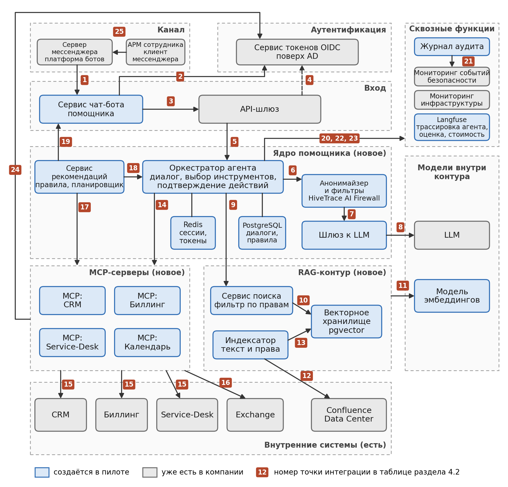

# Архитектурная диаграмма

Пилот «ИИ-помощник по внутренним процессам». Часть 1.1 тестового задания. Текст совпадает с разделом 4 сводного документа.

## 1. Диаграмма

Сотрудник работает с помощником со своего АРМ через обычный клиент мессенджера и напрямую к сервисам помощника не подключается. В сегменте мессенджера остаются сервер и платформа ботов, на которой регистрируется учётная запись бота. Сервис чат-бота — это серверное приложение помощника: платформа ботов передаёт ему сообщения сотрудников, а он возвращает ответы и уведомления. Его код относится к помощнику, поэтому он создаётся и разворачивается вместе с остальными сервисами.

## 2. Точки интеграции

Номера соответствуют рисунку 1. Все соединения защищены TLS, между сервисами помощника используется взаимная аутентификация (mTLS). Сервисы помощника взаимодействуют по принципу «точка-точка», без шины обмена данными. Через API-шлюз идут только запросы от имени сотрудника (точки 3 и 5): в нём проверяется токен и применяются лимиты. Внутренние вызовы, включая уведомления от сервиса рекомендаций к сервису чат-бота (точка 19), идут напрямую.

<!-- cols: 9,27,29,35 -->
| № | Откуда → куда | Что передаётся | Протокол и технология |
|---|---|---|---|
| 1 | Мессенджер → чат-бот | Сообщения сотрудника с его учётной записью | HTTPS, API ботов мессенджера, подпись сообщений |
| 2 | Чат-бот → сервис токенов | Запрос токена от имени сотрудника | OAuth 2.0, ограниченное делегирование |
| 3 | Чат-бот → API-шлюз | Сообщение и токен сотрудника | HTTPS, REST |
| 4 | API-шлюз → сервис токенов | Ключи для проверки подписи токена | OIDC, JWT, JWKS |
| 5 | API-шлюз → оркестратор | Запрос с токеном сотрудника | HTTPS, REST |
| 6, 7 | Оркестратор → анонимайзер → шлюз к LLM | Промпт с замаскированными данными | HTTPS, REST |
| 8 | Шлюз к LLM → LLM | Запрос к модели, вызовы инструментов | HTTPS, API модели |
| 9 | Оркестратор → сервис поиска | Вопрос и группы сотрудника | HTTPS, REST |
| 10 | Сервис поиска → хранилище | Векторный и полнотекстовый поиск с фильтром по правам | SQL, PostgreSQL с pgvector |
| 11 | Поиск и индексатор → модель эмбеддингов | Текст для векторизации | HTTPS, REST |
| 12 | Индексатор → Confluence | Изменённые страницы, их текст, версии, права чтения | HTTPS, REST API Confluence, JSON. Запросы инициирует индексатор по расписанию: изменения и права каждые 15 минут, полная сверка раз в сутки. Сервисная учётная запись только на чтение, персональный токен доступа |
| 13 | Индексатор → хранилище | Фрагменты, векторы, списки доступа | SQL |
| 14 | Оркестратор → MCP-серверы | Вызовы инструментов от имени сотрудника | MCP (JSON-RPC 2.0 поверх HTTP), токен сотрудника |
| 15 | MCP-серверы → CRM, биллинг, Service-Desk | Чтение статусов, создание обращения | HTTPS, REST API систем; токен системы, полученный в точке интеграции 24 |
| 16 | MCP календаря → Exchange | Встречи сотрудника | HTTPS, EWS |
| 17 | Сервис рекомендаций → MCP-серверы | Выборки по правилам | MCP; сервисная учётная запись только на чтение |
| 18 | Сервис рекомендаций → оркестратор | Сигнал для формулировки текста | HTTPS, REST |
| 19 | Сервис рекомендаций → сервис чат-бота | Уведомление сотруднику | HTTPS, REST; напрямую, «точка-точка» |
| 20, 21 | Оркестратор → журнал аудита → мониторинг безопасности | Запросы, вызовы, подтверждения, ответы | Kafka или syslog |
| 22 | Сервисы → мониторинг инфраструктуры | Метрики и трассировки сервисов | OpenTelemetry |
| 23 | Оркестратор, шлюз к LLM → Langfuse | Трассы агента, расход токенов, оценки | HTTPS, Langfuse SDK или OpenTelemetry |
| 24 | MCP-серверы → сервис токенов | Обмен токена сотрудника для помощника на токен конкретной системы | OAuth 2.0 Token Exchange (RFC 8693) |
| 25 | АРМ сотрудника → сервер мессенджера | Сообщения сотрудника, ответы и уведомления помощника | HTTPS, штатный протокол клиента мессенджера; существующая интеграция |

## 3. Компоненты, которые создаются

<!-- cols: 26,74 -->
| Компонент | Назначение |
|---|---|
| Сервис чат-бота | Серверное приложение помощника, зарегистрированное на платформе ботов мессенджера: принимает сообщения, показывает ответы, кнопки подтверждения и оценки, доставляет уведомления |
| Оркестратор агента | Ведёт диалог, выбирает между поиском по регламентам и вызовом инструмента, запрашивает подтверждение перед изменяющим действием |
| Анонимайзер | Обратимо маскирует чувствительные данные до LLM и подставляет их обратно в ответ |
| Защитные фильтры | HiveTrace AI Firewall, покупной российский продукт: проверяет вход, найденные фрагменты, вызовы инструментов и ответ |
| Шлюз к LLM | Единая точка доступа к модели: лимиты, учёт расхода, смена модели без переделки сервиса |
| RAG-контур | Индексатор забирает страницы и права из Confluence; хранилище держит фрагменты, векторы и списки доступа; сервис поиска выполняет гибридный поиск с фильтром по правам |
| MCP-серверы | Тонкие адаптеры поверх REST API систем с узким набором инструментов, по одному на систему |
| Сервис рекомендаций | Хранит правила, проверяет их по расписанию, рассылает сигналы |
| Redis | Состояние сессий и короткоживущие токены сотрудников |
| PostgreSQL | История диалогов, правила и подписки, векторный индекс |
| Журнал аудита | Неизменяемая запись всех запросов и действий для службы ИБ |
| Langfuse | Трассировка шагов агента, оценка качества в эксплуатации, подсчёт стоимости. Разворачивается внутри контура |

Новые компоненты пишутся на Python и разворачиваются в существующей платформе контейнеров.
