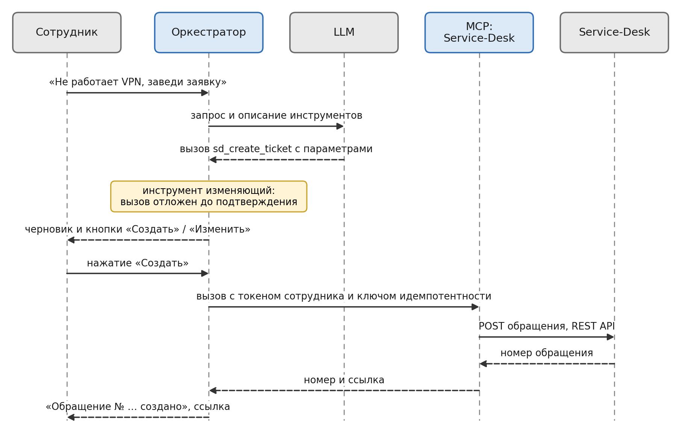
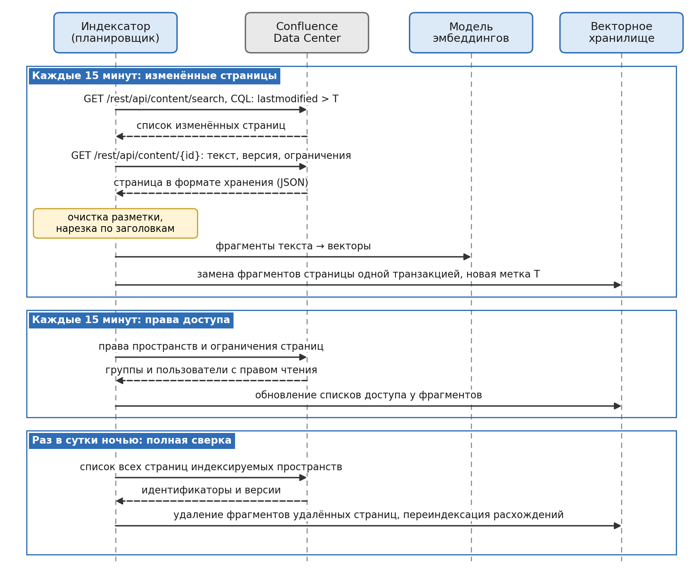
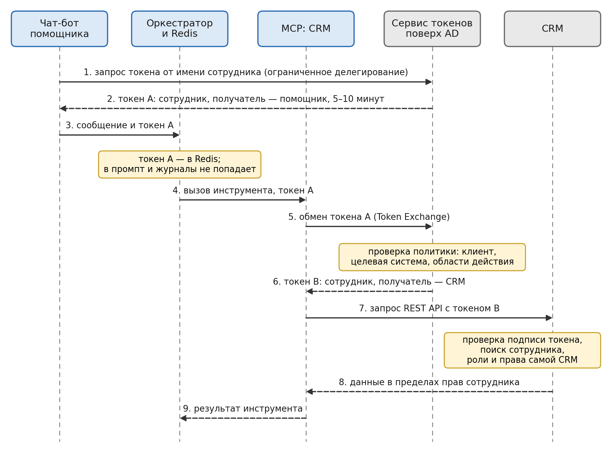
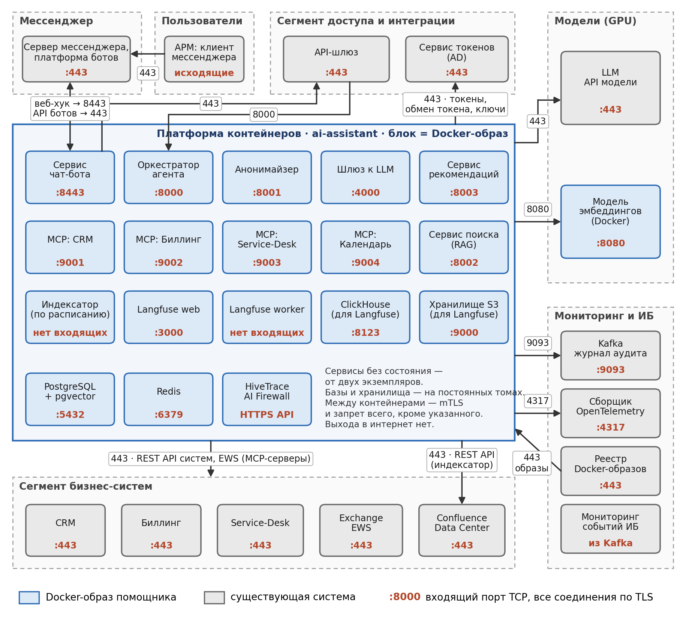

# Техническая архитектура

Пилот «ИИ-помощник по внутренним процессам». Часть 1.2 тестового задания. Текст совпадает с разделом 5 сводного документа.

## 1. Принципы

1. **Помощник не расширяет права сотрудника.** Он показывает и делает только то, что сотрудник может сам в исходной системе.
2. **Данные остаются в системах.** Статусы запрашиваются в момент вопроса; копируется только текст регламентов в поисковый индекс.
3. **Модель предлагает, код исполняет.** LLM выбирает инструмент и параметры, вызов выполняет оркестратор после проверок.
4. **Детерминированное там, где цена ошибки высока.** Права, подтверждения, условия рекомендаций и лимиты заданы кодом и конфигурацией, а не промптом.
5. **Всё внутри контура.** Модели, индекс, журналы и Langfuse размещены в инфраструктуре компании.
6. **Заменяемость.** Модель, канал и любая система меняются без переделки остальных частей.
## 2. Как обрабатывается запрос

**Вопрос о процессе.** Модель вызывает инструмент поиска. Сервис поиска выполняет гибридный поиск (векторный и полнотекстовый) с фильтром по группам сотрудника в AD и возвращает лучшие фрагменты. Модель отвечает только по ним, оркестратор добавляет ссылки и даты обновления страниц.

**Статус заявки или счёта.** Модель выбирает инструмент и параметры. Оркестратор восстанавливает замаскированные значения и вызывает MCP-сервер с токеном сотрудника. MCP-сервер обменивает токен на токен нужной системы и вызывает её API; права проверяет сама система.

**Создание обращения** показано на рисунке 2. Подтверждением считается только нажатие кнопки, которое обрабатывает оркестратор. Текст «да, создавай» внутри документа или заявки подтверждением не является, поэтому внедрённая в данные инструкция не может запустить действие.

{w=13.5}

**Рекомендации.** Планировщик запускает правила утром и каждые 30–60 минут. Правило делает выборку через MCP-сервер под сервисной учётной записью только на чтение. Сервис отбрасывает уже отправленные сигналы и отключённые правила, оркестратор формулирует текст, чат-бот доставляет его в рабочее время. Правило описывается конфигурацией: источник, условие, получатель, расписание, шаблон.

## 3. Индексация Confluence в RAG-контуре

Обмен в точке интеграции 12 всегда инициирует индексатор: Confluence ничего не отправляет сам. Индексатор работает по расписанию в трёх режимах, они показаны на рисунке 3.

{w=13}

<!-- cols: 22,18,60 -->
| Режим | Периодичность | Что происходит |
|---|---|---|
| Изменённые страницы | Каждые 15 минут | Поиск страниц, изменённых после метки прошлого запуска; загрузка текста; очистка разметки и нарезка по заголовкам; расчёт векторов; замена всех фрагментов страницы одной транзакцией |
| Права доступа | Каждые 15 минут | Выгрузка прав пространств и ограничений страниц с учётом наследования от родительских страниц; обновление списков групп и пользователей у фрагментов. Отдельный режим нужен потому, что смена прав не меняет дату изменения страницы |
| Полная сверка | Раз в сутки ночью | Сравнение списка страниц Confluence с индексом; удаление фрагментов удалённых и перенесённых страниц; переиндексация расхождений |

Первичная загрузка 3–5 пространств выполняется один раз перед запуском тем же индексатором. Периодичность задаётся конфигурацией: 15 минут — это предельная задержка, с которой в ответах появляется новая редакция регламента и перестаёт быть доступной закрытая страница. Членство сотрудника в группах AD в индексе не хранится: оно берётся из токена в момент запроса, поэтому исключение из группы действует сразу.

Для каждого фрагмента хранятся: идентификатор и версия страницы, пространство, путь заголовков, ссылка, дата обновления, текст, вектор, список групп и пользователей с правом чтения.

## 4. Идентификация и хранение токенов

**Как появляется токен.** Мессенджер передаёт чат-боту сообщение с учётной записью сотрудника в AD и подписью. Чат-бот проверяет подпись и запрашивает у сервиса токенов короткоживущий токен от имени этого сотрудника через ограниченное делегирование. Делегирование разрешено только для MCP-серверов помощника и только с правами пилота.

**Где токен хранится.** Токен не хранится ни в истории диалога, ни в состоянии агента, которое видит модель.

<!-- cols: 26,32,42 -->
| Что | Где хранится | Срок и защита |
|---|---|---|
| Токен сотрудника для помощника | Redis, запись сессии: ключ — идентификатор сессии, значение зашифровано | 5–10 минут, удаляется по истечении; при следующем сообщении чат-бот получает новый |
| Токены для CRM, биллинга, Service-Desk, календаря | Память MCP-сервера, кэш по паре «сотрудник — система» | Срок жизни токена, не дольше 5–10 минут; на диск не пишутся |
| Токены обновления | Не используются | В запасном варианте со входом по ссылке хранятся в хранилище секретов |
| Сервисная учётная запись рекомендаций и индексатора | Хранилище секретов платформы | Регулярная смена |

**Как токен доходит до системы.** Путь токена на примере CRM показан на рисунке 4. Токен A подтверждает личность сотрудника для сервисов помощника. MCP-сервер обменивает его в сервисе токенов на токен B, предназначенный только для CRM. Сервис токенов при обмене проверяет свою политику: разрешено ли этому MCP-серверу получать токены для CRM от имени сотрудников и с какими областями действия. Права сотрудника внутри CRM он не знает. Их применяет сама CRM: проверяет подпись токена B, находит сотрудника по учётной записи AD и использует свою ролевую модель, как при входе через интерфейс. Итоговые права — пересечение прав сотрудника в системе и областей действия, выданных помощнику; в пилоте области ограничены чтением и созданием обращений.

{w=13.5}

Схема требует, чтобы CRM, биллинг и Service-Desk принимали токены корпоративного сервиса токенов. Это проверяется на этапе подготовки. Для системы, которая так не умеет, запасные варианты — делегирование Kerberos или вызовы под сервисной учётной записью с передачей идентификатора сотрудника; второй вариант слабее и требует согласования службы ИБ.

**Как токен используется.** Оркестратор держит в состоянии сессии только идентификатор сотрудника и ссылку на запись в Redis. При вызове инструмента он достаёт токен и подставляет его в заголовок запроса к MCP-серверу. В промпт, в параметры инструментов, в журнал аудита и в Langfuse токен не попадает. Сотрудник в параметрах инструмента не указывается: MCP-сервер берёт его из токена, поэтому модель не может запросить данные от чужого имени.

**Рекомендации.** Сотрудника в диалоге нет, поэтому используется сервисная учётная запись с правом чтения только нужных выборок. Получателя определяет правило. Это единственное отступление от принципа «от имени сотрудника».

## 5. Инструменты агента

Создаются одиннадцать инструментов. Поиск по регламентам и рекомендации реализуются сервисами помощника, остальные — MCP-серверами систем.

<!-- cols: 30,14,23,33 -->
| Инструмент | Где реализован | Вход | Ответ |
|---|---|---|---|
| `search_regulations` | RAG-контур | `query`, `top_k` | Список фрагментов: `title`, `section`, `url`, `updated_at`, `text` |
| `crm_find_client` | MCP: CRM | `name` или `inn` | Список клиентов: `client_id`, `name`, `manager`, `url` |
| `billing_list_invoices` | MCP: Биллинг | `client_id`, `status`, `period` | Список счетов: `number`, `date`, `due_date`, `amount`, `status`, `overdue_days`, `url` |
| `billing_get_invoice` | MCP: Биллинг | `number` | Счёт с теми же полями и списком оплат `payments` |
| `sd_list_my_tickets` | MCP: Service-Desk | `role` (автор или исполнитель), `status` | Список обращений: `number`, `type`, `title`, `status`, `due_at`, `url` |
| `sd_get_ticket` | MCP: Service-Desk | `number` | Обращение с теми же полями, `assignee` и историей `history` |
| `sd_list_ticket_types` | MCP: Service-Desk | нет | Список типов: `type_id`, `name`, поля `fields` с признаком обязательности |
| `sd_create_ticket` | MCP: Service-Desk | `type_id`, `title`, `description`, `fields`, `idempotency_key` | `number`, `status`, `url`. Изменяющий, только после подтверждения |
| `calendar_list_my_events` | MCP: Календарь | `from`, `to` | Список встреч: `subject`, `start`, `end`, `organizer`, `attendees` |
| `recs_list_my` | Сервис рекомендаций | `date` | Список сигналов: `rule`, `text`, `object`, `url` |
| `recs_set_subscription` | Сервис рекомендаций | `rule`, `enabled` | Текущее состояние подписок сотрудника |

Общие правила: все входы проверяются по JSON-схеме; списки ограничены по размеру и возвращаются с признаком `has_more`; ошибка возвращается в едином виде `error: {code, message}` с кодами `forbidden`, `not_found`, `invalid_input`, `unavailable`. Инструмента «выполнить произвольный запрос к API» нет.

## 6. Трассировка, оценка и стоимость: Langfuse

Langfuse разворачивается внутри контура и подключается к оркестратору и шлюзу к LLM. Он нужен для трёх задач.

- **Трассировка действий агента.** Каждое сообщение сотрудника становится трассой, внутри которой видны все шаги: вызовы модели с промптом и ответом, найденные фрагменты, вызовы инструментов с параметрами и результатом, ожидание подтверждения, время и ошибки каждого шага. Трассы объединяются в сессию диалога и связаны идентификатором с журналом аудита.
- **Оценка в эксплуатации.** К трассе прикрепляются оценка сотрудника из чат-бота и автоматические оценки модели-оценщика на выборке диалогов: соответствие ответа найденным фрагментам, наличие ссылки, корректность выбора инструмента. Плохо оценённые трассы попадают в очередь разбора сервисной линии и пополняют тестовый набор, который тоже хранится в Langfuse и прогоняется перед каждым выпуском.
- **Подсчёт стоимости.** По каждому вызову модели учитываются входные и выходные токены. Для внутренней модели задаётся внутренняя цена токена, и стоимость считается в разрезе запроса, сценария, инструмента, подразделения и версии промпта.

В Langfuse отправляются уже замаскированные данные. Доступ к нему разграничен по ролям, срок хранения трасс ограничен. Langfuse не заменяет журнал аудита: журнал предназначен для службы ИБ и неизменяем, Langfuse — рабочий инструмент команды сервиса.

## 7. Защитные фильтры: HiveTrace AI Firewall

Проверки вокруг модели выполняет HiveTrace AI Firewall — российский продукт для защиты приложений на LLM с русскоязычными проверками. Он разворачивается внутри контура отдельным сервисом рядом с анонимайзером, и оркестратор обращается к нему в четырёх точках.

<!-- cols: 24,76 -->
| Точка проверки | Что проверяется |
|---|---|
| Вход | Попытки обойти ограничения и внедрить инструкции; запросы вне назначения помощника; маскирование персональных данных и реквизитов до отправки в модель |
| Найденные фрагменты | Инструкции, внедрённые в текст страниц Confluence; такие фрагменты отбрасываются до передачи модели |
| Вызов инструмента | Инструмент входит в разрешённый список; параметры соответствуют схеме; изменяющий инструмент не вызывается без отметки о подтверждении; в результате нет внедрённых инструкций |
| Ответ | Ответ опирается на найденные фрагменты и данные инструментов; нет чужих персональных данных и текста системного промпта; ссылки ведут только на внутренние домены |

По описанию вендора продукт закрывает промпт-атаки, утечку системных инструкций, отравление данных и избыточные действия агента. На этапе подготовки у вендора нужно подтвердить три вещи: поддержку каждой из четырёх точек проверки, установку в контуре без доступа в интернет и влияние на время ответа. Проверка параметров инструментов по схеме и отметки о подтверждении остаётся в коде оркестратора и от продукта не зависит. Обратимое маскирование выполняет собственный анонимайзер. Срабатывания фильтров записываются в журнал аудита и видны в трассах Langfuse. Фильтры дополняют, но не заменяют основную защиту: права по-прежнему проверяют целевые системы, а подтверждение действия обрабатывает оркестратор.

## 8. Обоснование решений

<!-- cols: 22,39,39 -->
| Решение | Почему так | Что отвергнуто |
|---|---|---|
| RAG по Confluence | Регламенты меняются; ответ проверяется по ссылке; права применяются при поиске | Дообучение модели: устаревает, не даёт ссылок, не учитывает права |
| Индексация по расписанию | Работает с любой версией Confluence через штатный REST API; задержка 15 минут приемлема для регламентов | Веб-хуки Confluence: быстрее, но требуют настройки на стороне Confluence и всё равно нуждаются в сверке |
| Один агент с инструментами | Сценариев мало; проще отлаживать и оценивать | Несколько агентов: сложнее и медленнее без выигрыша |
| Запрос данных в момент вопроса | Данные свежие; права проверяет система; нет копии чувствительных данных | Витрина данных: дублирует права и данные |
| MCP-серверы поверх REST API | Единый протокол; серверы переиспользуются другими ИИ-сервисами; систему можно заменить, не трогая агента | Прямые вызовы API из оркестратора: интеграции смешиваются с логикой агента |
| Вызовы от имени сотрудника | Не нужна своя модель прав; ошибка модели не открывает чужие данные | Сервисная учётная запись с полным доступом |
| Токен в Redis, а не в состоянии агента | Модель и журналы не видят токен; срок жизни ограничен | Токен в истории диалога или в PostgreSQL: долгое хранение, риск утечки |
| Рекомендации по правилам | Проверяемы и объяснимы; у правила есть владелец | Рекомендации от LLM по всем данным: непредсказуемо и дорого |
| PostgreSQL с pgvector | Объём небольшой; фильтр по правам обычным SQL | Отдельная векторная база: лишняя система в пилоте |
| HiveTrace AI Firewall для фильтров | Готовый продукт с русскоязычными проверками; не нужно писать и поддерживать собственные проверочные промпты | NeMo Guardrails: открытый конструктор, но встроенные проверки рассчитаны на английский; ограничения только в системном промпте: обходятся |
| Обратимая псевдонимизация | Модель не видит реальных значений, а инструменты работают с ними | Необратимое маскирование: запрос по конкретному клиенту невозможен |
| Langfuse внутри контура | Трассировка, оценки и стоимость в одном инструменте; открытый код, данные не покидают контур | Только общий мониторинг: не показывает шаги агента и качество ответов |

## 9. Нефункциональные характеристики

- **Скорость.** Число шагов агента и время вызова систем ограничены; в мессенджере сразу показывается индикатор набора ответа.
- **Отказы.** Если система недоступна, помощник сообщает, какая именно, и отвечает на остальную часть вопроса. При недоступности модели бот отвечает заготовленным сообщением. Недоступность Langfuse на работу помощника не влияет.- **Масштабирование.** Сервисы не хранят состояние и запускаются минимум в двух экземплярах. Узкое место — производительность модели; лимиты задаёт шлюз к LLM.

## 10. Развёртывание

Каждый новый компонент собирается в отдельный Docker-образ и публикуется во внутреннем реестре. Образы запускаются в существующей платформе контейнеров в отдельном пространстве имён; для разработки и прототипа те же образы поднимаются через Docker Compose. Размещение и порты показаны на рисунке 5.

{w=15.5}

Порты контейнеров помощника назначены проектом и меняются конфигурацией; для существующих систем указаны стандартные порты. Наружу из пространства имён открыты только два входящих порта: 8443 для сообщений мессенджера и 8000 для API-шлюза. Сетевые доступы между сегментами, которые нужно согласовать:

<!-- cols: 34,32,12,22 -->
| Источник | Назначение | Порт | Протокол |
|---|---|---|---|
| АРМ сотрудника | Сервер мессенджера | 443 | HTTPS, уже открыт |
| Сервер мессенджера | Сервис чат-бота | 8443 | HTTPS, веб-хук |
| Сервис чат-бота | Сервер мессенджера | 443 | HTTPS, API ботов |
| Чат-бот | API-шлюз | 443 | HTTPS |
| API-шлюз | Оркестратор | 8000 | HTTPS |
| Чат-бот, MCP-серверы | Сервис токенов | 443 | HTTPS, OAuth 2.0 |
| Шлюз к LLM | LLM | 443 | HTTPS |
| Сервис поиска, индексатор | Модель эмбеддингов | 8080 | HTTPS |
| MCP-серверы | CRM, биллинг, Service-Desk | 443 | HTTPS, REST |
| MCP календаря | Exchange | 443 | HTTPS, EWS |
| Индексатор | Confluence | 443 | HTTPS, REST |
| Оркестратор | Kafka | 9093 | Kafka поверх TLS |
| Все сервисы | Сборщик OpenTelemetry | 4317 | OTLP, gRPC |
| Платформа контейнеров | Реестр Docker-образов | 443 | HTTPS |

Сервисы без состояния запускаются не менее чем в двух экземплярах. Индексатор и планировщик рекомендаций работают в одном экземпляре, чтобы задания не выполнялись дважды. PostgreSQL, Redis, а также ClickHouse и объектное хранилище для Langfuse используют постоянные тома. Секреты подставляются из хранилища секретов платформы и в образы не попадают.
