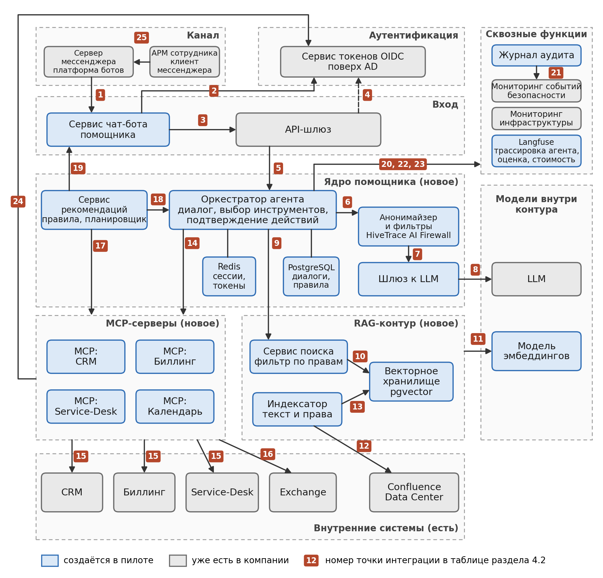
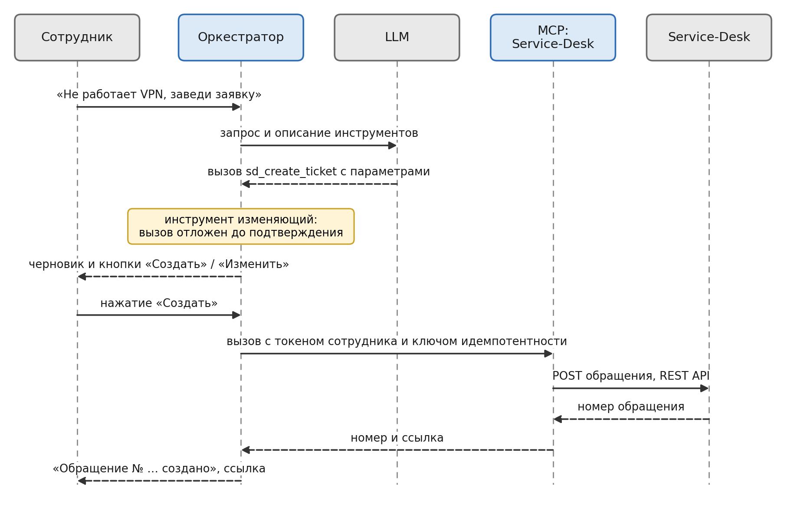
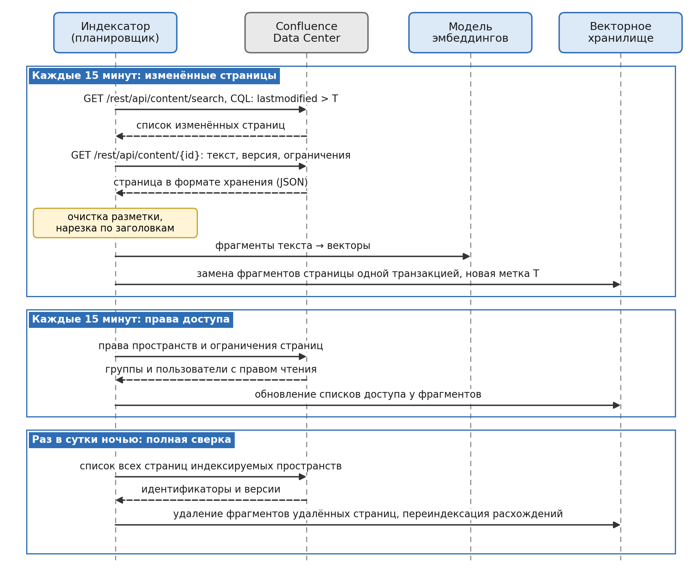
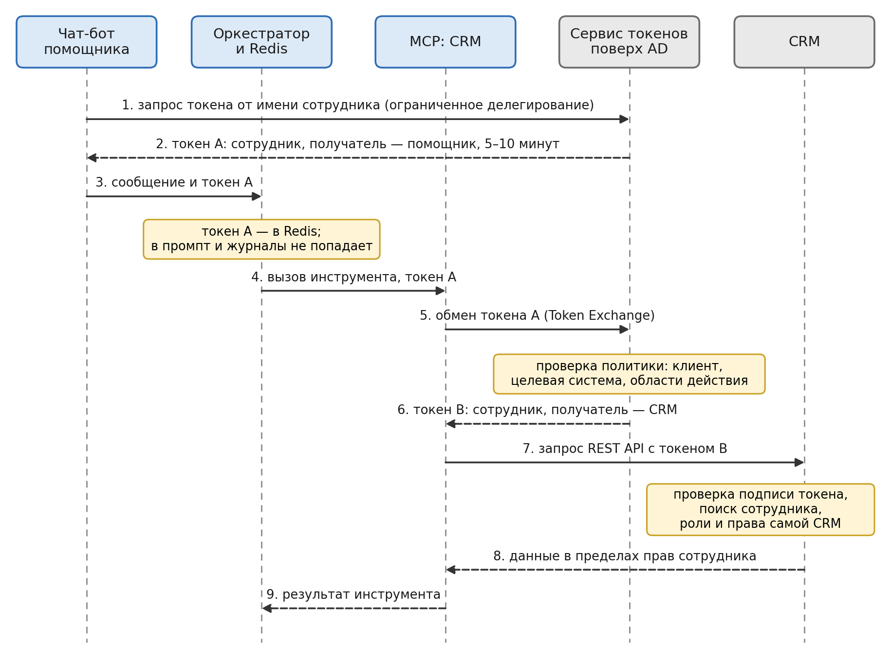
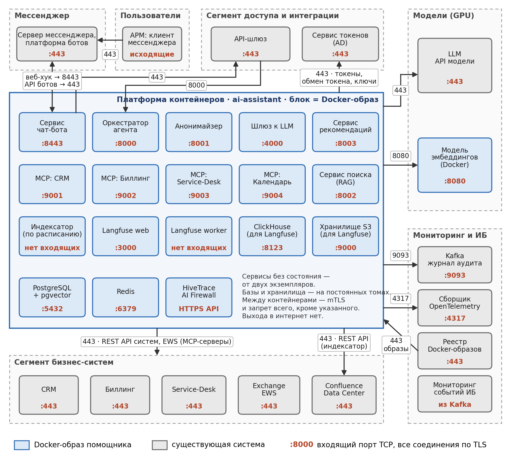

# ИИ-помощник по внутренним процессам

Архитектурное решение пилотного AI-сервиса для сотрудников

## 1. Задача

В компании работают CRM, биллинг, Service-Desk и портал документации Confluence. Нужно запустить пилотный сервис, который:

- отвечает на вопросы сотрудников о процессах («как оформить отпуск?», «как подать заявку на закупку?»);
- подсказывает статус заявок и счетов по данным внутренних систем;
- рекомендует действия («по клиенту есть просроченный счёт», «завтра встреча с руководителем, подготовь отчёт»).

Решение в одном абзаце: ИИ-агент на модели внутри контура компании отвечает по регламентам через поиск в Confluence (RAG), а статусы получает из систем через инструменты, вызываемые от имени сотрудника. Рекомендации формирует отдельный сервис по настраиваемым правилам. В пилоте помощник читает данные и умеет одно изменяющее действие: создать обращение в Service-Desk после подтверждения сотрудником.

## 2. Вопросы и допущения

Вопросы, которые нужно задать заказчику, и допущения, принятые для проектирования.

<!-- cols: 5,33,62 -->
| № | Вопрос | Принятое допущение |
|---|---|---|
| 1 | Кто пользователи пилота и сколько их? | 200–500 сотрудников двух-трёх подразделений; после пилота вся компания |
| 2 | По каким метрикам оценивается успех? | Доля корректных ответов не ниже 85 %, доля вопросов без обращения в Service-Desk, оценки и активность пользователей |
| 3 | Через какой канал общается сотрудник? | Чат-бот в корпоративном мессенджере, включая мобильную версию. Рекомендации приходят туда же |
| 4 | Помощник только читает данные или изменяет? | Чтение и одно изменяющее действие: создание обращения в Service-Desk с подтверждением. Изменения в CRM и биллинге на втором этапе |
| 5 | Какая версия Confluence, сколько контента? | Data Center внутри контура, REST API; в пилот берутся 3–5 проверенных пространств |
| 6 | Разграничен ли доступ к страницам? | Да. Помощник показывает только то, что сотрудник может открыть сам |
| 7 | Есть ли источники знаний вне Confluence? | В пилоте только Confluence |
| 8 | Какие интерфейсы у CRM, биллинга, Service-Desk? | Системы кастомные, у каждой есть REST API. Готовых MCP-серверов нет, они пишутся как адаптеры |
| 9 | Чьи заявки и счета видит сотрудник? | Те же, что в исходной системе: свои заявки, клиентов своего портфеля, руководитель видит данные подчинённых |
| 10 | Есть ли перечень рекомендаций и кто его владелец? | Перечня нет. В пилоте четыре правила, владельцы — бизнес-подразделения |
| 11 | Рекомендации приходят сами или по запросу? | Оба варианта: утренняя сводка, срочные сигналы и ответ на вопрос «что мне важно сделать?» |
| 12 | Что рекомендовать, решают правила или модель? | Правила. Модель только формулирует текст |
| 13 | Где планируются встречи? | Календарь Exchange. Это пятая интеграция, которой нет в перечне задания |
| 14 | Отдают ли системы события? | Нет, сервис рекомендаций опрашивает их по расписанию |
| 15 | Есть ли единая учётная запись сотрудника? | Да, AD. Поверх AD работает сервис выдачи токенов OIDC |
| 16 | Какие данные обрабатываются, допустима ли внешняя LLM? | Есть персональные данные и коммерческая тайна, возможна банковская. Внешние модели запрещены, модель размещена внутри контура |
| 17 | Требования к журналированию? | Журналируются все запросы, вызовы и ответы; журналы передаются в систему мониторинга событий безопасности; чувствительные данные обратимо маскируются до отправки в LLM |
| 18 | Требования к скорости и доступности? | Реакция на сообщение (индикатор набора) до 5 секунд, полный ответ до 20 секунд, доступность 99 % в рабочее время |
| 19 | Есть ли готовая инфраструктура для ИИ? | Есть платформа контейнеров и доступ к внутренней LLM через API |
| 20 | Есть ли корпоративная система интеграции приложений (шина обмена данными)? | В пилоте шина данных не используется: сервисы помощника обращаются к системам напрямую по их REST API, «точка-точка» |

## 3. Бизнес-архитектура

### 3.1. Цель и эффект

Сотрудник получает ответ о процессе, статус заявки или счёта и напоминание о важном деле в одном окне мессенджера, не переходя между системами. Ожидаемый эффект:

- снижение числа типовых обращений в Service-Desk и к коллегам из бэк-офиса;
- снижение времени на поиск регламентов и статусов;
- снижение количества пропущенных сроков по счетам и заявкам.

### 3.2. Участники

<!-- cols: 30,70 -->
| Роль | Участие |
|---|---|
| Сотрудник | Спрашивает о процессах, узнаёт статусы своих заявок, создаёт обращения |
| Менеджер по продажам или клиентскому сервису | Узнаёт статусы счетов клиентов своего портфеля, получает напоминания о просрочке и встречах |
| Исполнитель Service-Desk | Получает напоминания о заявках без движения, по которым он ответственный |
| Руководитель | Те же функции, а также обращения подчинённых и счета их клиентов; календарь только свой |
| Владелец пространства Confluence | Поддерживает актуальность регламентов, получает сигналы о плохо оценённых ответах |
| Владелец правил рекомендаций | Определяет правила и пороги, видит статистику срабатываний |
| Сервисная линия | Развивает сервис, разбирает ошибки |
| Служба информационной безопасности | Согласует доступы, контролирует события по журналу |

### 3.3. Сценарии

**Вопрос о процессе.** Помощник находит фрагменты регламентов среди страниц, доступных сотруднику, отвечает по шагам и даёт ссылки на источники с датой обновления. Если регламента нет, он прямо говорит об этом и предлагает создать обращение.

**Статус заявки или счёта.** Помощник запрашивает данные в нужной системе от имени сотрудника и отвечает кратко со ссылкой на карточку. Сотрудник видит то же, что увидел бы в самой системе.

**Создание обращения.** Помощник подбирает тип обращения, заполняет поля и показывает черновик. Обращение создаётся только после нажатия кнопки подтверждения.

**Рекомендации.** Приходят сами (утренняя сводка и срочные сигналы) и по запросу. Сотрудник может отключить отдельные правила. Правила пилота:

<!-- cols: 44,24,32 -->
| Правило | Источник | Кому приходит |
|---|---|---|
| У клиента просроченный счёт | Биллинг, CRM | Ответственному менеджеру |
| У счёта подходит срок оплаты | Биллинг, CRM | Ответственному менеджеру |
| Завтра встреча с руководителем или клиентом | Календарь | Участнику встречи |
| Заявка долго без движения или истекает срок | Service-Desk | Ответственному исполнителю |

### 3.4. Границы и метрики пилота

<!-- cols: 50,50 -->
| Входит в пилот | Не входит в пилот |
|---|---|
| 200–500 сотрудников двух-трёх подразделений | Вся компания |
| 3–5 проверенных пространств Confluence | Остальные пространства, файлы, почта, база знаний Service-Desk |
| Чтение данных CRM, биллинга, Service-Desk, календаря | Изменение данных в CRM и биллинге |
| Создание обращения в Service-Desk с подтверждением | Изменение статусов и другие действия с обращениями |
| Четыре правила рекомендаций, опрос по расписанию | Произвольные правила, события в реальном времени |
| Чат-бот в мессенджере, русский язык | Виджет на портале, голосовой канал, встраивание в интерфейсы систем |

<!-- cols: 34,40,26 -->
| Метрика | Как измеряется | Цель |
|---|---|---|
| Доля корректных ответов | Тестовый набор вопросов с эталонными ответами | Не ниже 85 % |
| Доля вопросов без обращения в Service-Desk | Диалоги без последующего обращения по той же теме | После первого месяца |
| Оценка пользователей | Доля положительных оценок ответов | После первого месяца |
| Активность | Доля пользователей пилота за неделю | После первого месяца |
| Полезность рекомендаций | Переходы по ссылке, доля отключённых правил | После первого месяца |
| Скорость | Время до индикатора набора и до полного ответа | До 5 и до 20 секунд |

Для четырёх метрик исходных значений нет, поэтому первый месяц уходит на замер, после чего ставятся цели.

## 4. Архитектура системы

### 4.1. Диаграмма

Сотрудник работает с помощником со своего АРМ через обычный клиент мессенджера и напрямую к сервисам помощника не подключается. В сегменте мессенджера остаются сервер и платформа ботов, на которой регистрируется учётная запись бота. Сервис чат-бота — это серверное приложение помощника: платформа ботов передаёт ему сообщения сотрудников, а он возвращает ответы и уведомления. Его код относится к помощнику, поэтому он создаётся и разворачивается вместе с остальными сервисами.

### 4.2. Точки интеграции

Номера соответствуют рисунку 1. Все соединения защищены TLS, между сервисами помощника используется взаимная аутентификация (mTLS). Сервисы помощника взаимодействуют по принципу «точка-точка», без шины обмена данными. Через API-шлюз идут только запросы от имени сотрудника (точки 3 и 5): в нём проверяется токен и применяются лимиты. Внутренние вызовы, включая уведомления от сервиса рекомендаций к сервису чат-бота (точка 19), идут напрямую.

<!-- cols: 9,27,29,35 -->
| № | Откуда → куда | Что передаётся | Протокол и технология |
|---|---|---|---|
| 1 | Мессенджер → чат-бот | Сообщения сотрудника с его учётной записью | HTTPS, API ботов мессенджера, подпись сообщений |
| 2 | Чат-бот → сервис токенов | Запрос токена от имени сотрудника | OAuth 2.0, ограниченное делегирование |
| 3 | Чат-бот → API-шлюз | Сообщение и токен сотрудника | HTTPS, REST |
| 4 | API-шлюз → сервис токенов | Ключи для проверки подписи токена | OIDC, JWT, JWKS |
| 5 | API-шлюз → оркестратор | Запрос с токеном сотрудника | HTTPS, REST |
| 6, 7 | Оркестратор → анонимайзер → шлюз к LLM | Промпт с замаскированными данными | HTTPS, REST |
| 8 | Шлюз к LLM → LLM | Запрос к модели, вызовы инструментов | HTTPS, API модели |
| 9 | Оркестратор → сервис поиска | Вопрос и группы сотрудника | HTTPS, REST |
| 10 | Сервис поиска → хранилище | Векторный и полнотекстовый поиск с фильтром по правам | SQL, PostgreSQL с pgvector |
| 11 | Поиск и индексатор → модель эмбеддингов | Текст для векторизации | HTTPS, REST |
| 12 | Индексатор → Confluence | Изменённые страницы, их текст, версии, права чтения | HTTPS, REST API Confluence, JSON. Запросы инициирует индексатор по расписанию: изменения и права каждые 15 минут, полная сверка раз в сутки. Сервисная учётная запись только на чтение, персональный токен доступа |
| 13 | Индексатор → хранилище | Фрагменты, векторы, списки доступа | SQL |
| 14 | Оркестратор → MCP-серверы | Вызовы инструментов от имени сотрудника | MCP (JSON-RPC 2.0 поверх HTTP), токен сотрудника |
| 15 | MCP-серверы → CRM, биллинг, Service-Desk | Чтение статусов, создание обращения | HTTPS, REST API систем; токен системы, полученный в точке интеграции 24 |
| 16 | MCP календаря → Exchange | Встречи сотрудника | HTTPS, EWS |
| 17 | Сервис рекомендаций → MCP-серверы | Сервисные выборки по правилам (раздел 5.5) | MCP; сервисная учётная запись только на чтение |
| 18 | Сервис рекомендаций → оркестратор | Сигнал для формулировки текста | HTTPS, REST |
| 19 | Сервис рекомендаций → сервис чат-бота | Уведомление сотруднику | HTTPS, REST; напрямую, «точка-точка» |
| 20, 21 | Оркестратор, сервис чат-бота, MCP-серверы, сервис рекомендаций → журнал аудита → мониторинг безопасности | Запросы, вызовы, подтверждения, ответы; обмены токенов и обращения к системам; отправленные уведомления. Записи связаны сквозным идентификатором запроса. На рисунке 1 для простоты показана одна стрелка, от оркестратора | Kafka или syslog |
| 22 | Сервисы → мониторинг инфраструктуры | Метрики и трассировки сервисов | OpenTelemetry |
| 23 | Оркестратор, шлюз к LLM → Langfuse | Трассы агента, расход токенов, оценки | HTTPS, Langfuse SDK или OpenTelemetry |
| 24 | MCP-серверы → сервис токенов | Обмен токена сотрудника для помощника на токен конкретной системы | OAuth 2.0 Token Exchange (RFC 8693) |
| 25 | АРМ сотрудника → сервер мессенджера | Сообщения сотрудника, ответы и уведомления помощника | HTTPS, штатный протокол клиента мессенджера; существующая интеграция |

### 4.3. Компоненты, которые создаются

<!-- cols: 26,74 -->
| Компонент | Назначение |
|---|---|
| Сервис чат-бота | Серверное приложение помощника, зарегистрированное на платформе ботов мессенджера: принимает сообщения, показывает ответы, кнопки подтверждения и оценки, доставляет уведомления |
| Оркестратор агента | Ведёт диалог, выбирает между поиском по регламентам и вызовом инструмента, запрашивает подтверждение перед изменяющим действием |
| Анонимайзер | Обратимо маскирует чувствительные данные до LLM и подставляет их обратно в ответ |
| Защитные фильтры | HiveTrace AI Firewall, покупной российский продукт: проверяет вход, найденные фрагменты, вызовы инструментов и ответ |
| Шлюз к LLM | Единая точка доступа к модели: лимиты, учёт расхода, смена модели без переделки сервиса |
| RAG-контур | Индексатор забирает страницы и права из Confluence; хранилище держит фрагменты, векторы и списки доступа; сервис поиска выполняет гибридный поиск с фильтром по правам |
| MCP-серверы | Тонкие адаптеры поверх REST API систем с узким набором инструментов, по одному на систему |
| Сервис рекомендаций | Хранит правила, проверяет их по расписанию, рассылает сигналы |
| Redis | Состояние сессий и короткоживущие токены сотрудников |
| PostgreSQL | История диалогов, правила и подписки, векторный индекс |
| Журнал аудита | Неизменяемая запись всех запросов и действий для службы ИБ |
| Langfuse | Трассировка шагов агента, оценка качества в эксплуатации, подсчёт стоимости. Разворачивается внутри контура |

Новые компоненты пишутся на Python и разворачиваются в существующей платформе контейнеров.

## 5. Техническая архитектура

### 5.1. Принципы

1. **Помощник не расширяет права сотрудника.** Он показывает и делает только то, что сотрудник может сам в исходной системе.
2. **Данные остаются в системах.** Статусы запрашиваются в момент вопроса; копируется только текст регламентов в поисковый индекс.
3. **Модель предлагает, код исполняет.** LLM выбирает инструмент и параметры, вызов выполняет оркестратор после проверок.
4. **Детерминированное там, где цена ошибки высока.** Права, подтверждения, условия рекомендаций и лимиты заданы кодом и конфигурацией, а не промптом.
5. **Всё внутри контура.** Модели, индекс, журналы и Langfuse размещены в инфраструктуре компании.
6. **Заменяемость.** Модель, канал и любая система меняются без переделки остальных частей.

### 5.2. Как обрабатывается запрос

**Вопрос о процессе.** Модель вызывает инструмент поиска. Сервис поиска выполняет гибридный поиск (векторный и полнотекстовый) с фильтром по группам сотрудника в AD и возвращает лучшие фрагменты. Модель отвечает только по ним, оркестратор добавляет ссылки и даты обновления страниц.

**Статус заявки или счёта.** Модель выбирает инструмент и параметры. Оркестратор восстанавливает замаскированные значения и вызывает MCP-сервер с токеном сотрудника. MCP-сервер обменивает токен на токен нужной системы и вызывает её API; права проверяет сама система.

**Создание обращения** показано на рисунке 2. Подтверждением считается только нажатие кнопки, которое обрабатывает оркестратор. Текст «да, создавай» внутри документа или заявки подтверждением не является, поэтому внедрённая в данные инструкция не может запустить действие.

{w=13.5}

**Рекомендации.** Планировщик запускает правила утром и каждые 30–60 минут. Правило делает выборку через MCP-сервер сервисной выборкой (раздел 5.5) под сервисной учётной записью только на чтение. Сервис отбрасывает уже отправленные сигналы и отключённые правила, оркестратор формулирует текст, чат-бот доставляет его в рабочее время. Правило описывается конфигурацией: источник, условие, получатель, расписание, шаблон.

### 5.3. Индексация Confluence в RAG-контуре

Обмен в точке интеграции 12 всегда инициирует индексатор: Confluence ничего не отправляет сам. Индексатор работает по расписанию в трёх режимах, они показаны на рисунке 3.

{w=13}

<!-- cols: 22,18,60 -->
| Режим | Периодичность | Что происходит |
|---|---|---|
| Изменённые страницы | Каждые 15 минут | Поиск страниц, изменённых после метки прошлого запуска; загрузка текста; очистка разметки и нарезка по заголовкам; расчёт векторов; замена всех фрагментов страницы одной транзакцией |
| Права доступа | Каждые 15 минут | Выгрузка прав пространств и ограничений страниц с учётом наследования от родительских страниц; обновление списков групп и пользователей у фрагментов. Отдельный режим нужен потому, что смена прав не меняет дату изменения страницы |
| Полная сверка | Раз в сутки ночью | Сравнение списка страниц Confluence с индексом; удаление фрагментов удалённых и перенесённых страниц; переиндексация расхождений |

Первичная загрузка 3–5 пространств выполняется один раз перед запуском тем же индексатором. Периодичность задаётся конфигурацией: 15 минут — это предельная задержка, с которой в ответах появляется новая редакция регламента и перестаёт быть доступной закрытая страница. Членство сотрудника в группах AD в индексе не хранится: оно берётся из токена в момент запроса, поэтому исключение из группы действует сразу.

Для каждого фрагмента хранятся: идентификатор и версия страницы, пространство, путь заголовков, ссылка, дата обновления, текст, вектор, список групп и пользователей с правом чтения.

### 5.4. Идентификация и хранение токенов

**Как появляется токен.** Мессенджер передаёт чат-боту сообщение с учётной записью сотрудника в AD и подписью. Чат-бот проверяет подпись и запрашивает у сервиса токенов короткоживущий токен от имени этого сотрудника через ограниченное делегирование. Делегирование разрешено только для MCP-серверов помощника и только с правами пилота.

**Где токен хранится.** Токен не хранится ни в истории диалога, ни в состоянии агента, которое видит модель.

<!-- cols: 26,32,42 -->
| Что | Где хранится | Срок и защита |
|---|---|---|
| Токен сотрудника для помощника | Redis, запись сессии: ключ — идентификатор сессии, значение зашифровано | 5–10 минут, удаляется по истечении; при следующем сообщении чат-бот получает новый |
| Токены для CRM, биллинга, Service-Desk, календаря | Память MCP-сервера, кэш по паре «сотрудник — система» | Срок жизни токена, не дольше 5–10 минут; на диск не пишутся |
| Токены обновления | Не используются | В запасном варианте со входом по ссылке хранятся в хранилище секретов |
| Сервисная учётная запись рекомендаций и индексатора | Хранилище секретов платформы | Регулярная смена |

**Как токен доходит до системы.** Путь токена на примере CRM показан на рисунке 4. Токен A подтверждает личность сотрудника для сервисов помощника. MCP-сервер обменивает его в сервисе токенов на токен B, предназначенный только для CRM. Сервис токенов при обмене проверяет свою политику: разрешено ли этому MCP-серверу получать токены для CRM от имени сотрудников и с какими областями действия. Права сотрудника внутри CRM он не знает. Их применяет сама CRM: проверяет подпись токена B, находит сотрудника по учётной записи AD и использует свою ролевую модель, как при входе через интерфейс. Итоговые права — пересечение прав сотрудника в системе и областей действия, выданных помощнику; в пилоте области ограничены чтением и созданием обращений.

{w=11.5}

Схема требует, чтобы CRM, биллинг и Service-Desk принимали токены корпоративного сервиса токенов. Это проверяется на этапе подготовки. Для системы, которая так не умеет, запасные варианты — делегирование Kerberos или вызовы под сервисной учётной записью с передачей идентификатора сотрудника; второй вариант слабее и требует согласования службы ИБ.

**Как токен используется.** Оркестратор держит в состоянии сессии только идентификатор сотрудника и ссылку на запись в Redis. При вызове инструмента он достаёт токен и подставляет его в заголовок запроса к MCP-серверу. В промпт, в параметры инструментов, в журнал аудита и в Langfuse токен не попадает. Сотрудник, от имени которого выполняется вызов, в параметрах инструмента не указывается: MCP-сервер берёт его из токена, поэтому модель не может запросить данные от чужого имени. Параметр `employee` в `sd_list_my_tickets` личность не меняет: вызов идёт с токеном руководителя, и система сама решает, вправе ли он видеть обращения этого сотрудника.

**Рекомендации.** Сотрудника в диалоге нет, поэтому используется сервисная учётная запись с правом только на четыре сервисные выборки из раздела 5.5. Получателя определяет правило. Это единственное отступление от принципа «от имени сотрудника».

### 5.5. Инструменты агента

Создаются одиннадцать инструментов агента и четыре сервисные выборки для правил рекомендаций. Поиск по регламентам и рекомендации реализуются сервисами помощника, остальные — MCP-серверами систем.

<!-- cols: 30,14,23,33 -->
| Инструмент | Где реализован | Вход | Ответ |
|---|---|---|---|
| `search_regulations` | RAG-контур | `query`, `top_k` | Список фрагментов: `title`, `section`, `url`, `updated_at`, `text` |
| `crm_find_client` | MCP: CRM | `name` или `inn` | Список клиентов: `client_id`, `name`, `manager`, `url` |
| `billing_list_invoices` | MCP: Биллинг | `client_id`, `status`, `period` | Список счетов: `number`, `date`, `due_date`, `amount`, `status`, `overdue_days`, `url` |
| `billing_get_invoice` | MCP: Биллинг | `number` | Счёт с теми же полями и списком оплат `payments` |
| `sd_list_my_tickets` | MCP: Service-Desk | `role` (автор или исполнитель), `status`, необязательный `employee` (подчинённый) | Список обращений: `number`, `type`, `title`, `status`, `due_at`, `url` |
| `sd_get_ticket` | MCP: Service-Desk | `number` | Обращение с теми же полями, `assignee` и историей `history` |
| `sd_list_ticket_types` | MCP: Service-Desk | нет | Список типов: `type_id`, `name`, поля `fields` с признаком обязательности |
| `sd_create_ticket` | MCP: Service-Desk | `type_id`, `title`, `description`, `fields`, `idempotency_key` | `number`, `status`, `url`. Изменяющий, только после подтверждения |
| `calendar_list_my_events` | MCP: Календарь | `from`, `to` | Список встреч: `subject`, `start`, `end`, `organizer`, `attendees` |
| `recs_list_my` | Сервис рекомендаций | `date` | Список сигналов: `rule`, `text`, `object`, `url` |
| `recs_set_subscription` | Сервис рекомендаций | `rule`, `enabled` | Текущее состояние подписок сотрудника |

Общие правила: все входы проверяются по JSON-схеме; списки ограничены по размеру и возвращаются с признаком `has_more`; ошибка возвращается в едином виде `error: {code, message}` с кодами `forbidden`, `not_found`, `invalid_input`, `unavailable`. Инструмента «выполнить произвольный запрос к API» нет.

Данные подчинённых руководитель получает теми же инструментами со своим токеном. Клиентов и счета подчинённых ему отдают CRM и биллинг по своей ролевой модели. Для обращений подчинённого в `sd_list_my_tickets` указывается `employee`: это фильтр выборки, а право руководителя на эти обращения проверяет Service-Desk. Календарь доступен только свой.

Сервисные выборки нужны правилам рекомендаций, которым требуются данные по всем сотрудникам пилота, а не по одному. Их реализуют те же MCP-серверы, но в список инструментов агента они не входят: MCP-сервер выполняет их только по токену сервисной учётной записи рекомендаций, оркестратор и модель вызвать их не могут.

<!-- cols: 30,14,23,33 -->
| Сервисная выборка | Где реализована | Вход | Ответ |
|---|---|---|---|
| `billing_select_invoices` | MCP: Биллинг | `status`, `due_before` | Просроченные счета и счета с подходящим сроком по всем клиентам: `number`, `client_id`, `due_date`, `amount`, `overdue_days`, `url` |
| `crm_select_client_managers` | MCP: CRM | `client_ids` | Ответственные менеджеры: `client_id`, `name`, `manager` |
| `sd_select_stale_tickets` | MCP: Service-Desk | `idle_days`, `due_within` | Обращения без движения или с истекающим сроком: `number`, `title`, `assignee`, `status`, `due_at`, `url` |
| `calendar_select_events` | MCP: Календарь | `date`, `users` | Встречи сотрудников пилота на дату: `user`, `subject`, `start`, `organizer`, `attendees` |

### 5.6. Трассировка, оценка и стоимость: Langfuse

Langfuse разворачивается внутри контура и подключается к оркестратору и шлюзу к LLM. Он нужен для трёх задач.

- **Трассировка действий агента.** Каждое сообщение сотрудника становится трассой, внутри которой видны все шаги: вызовы модели с промптом и ответом, найденные фрагменты, вызовы инструментов с параметрами и результатом, ожидание подтверждения, время и ошибки каждого шага. Трассы объединяются в сессию диалога и связаны идентификатором с журналом аудита.
- **Оценка в эксплуатации.** К трассе прикрепляются оценка сотрудника из чат-бота и автоматические оценки модели-оценщика на выборке диалогов: соответствие ответа найденным фрагментам, наличие ссылки, корректность выбора инструмента. Плохо оценённые трассы попадают в очередь разбора сервисной линии и пополняют тестовый набор, который тоже хранится в Langfuse и прогоняется перед каждым выпуском.
- **Подсчёт стоимости.** По каждому вызову модели учитываются входные и выходные токены. Для внутренней модели задаётся внутренняя цена токена, и стоимость считается в разрезе запроса, сценария, инструмента, подразделения и версии промпта.

В Langfuse отправляются уже замаскированные данные. Доступ к нему разграничен по ролям, срок хранения трасс ограничен. Langfuse не заменяет журнал аудита: журнал предназначен для службы ИБ и неизменяем, Langfuse — рабочий инструмент команды сервиса.

### 5.7. Защитные фильтры: HiveTrace AI Firewall

Проверки вокруг модели выполняет HiveTrace AI Firewall — российский продукт для защиты приложений на LLM с русскоязычными проверками. Он разворачивается внутри контура отдельным сервисом рядом с анонимайзером, и оркестратор обращается к нему в четырёх точках.

<!-- cols: 24,76 -->
| Точка проверки | Что проверяется |
|---|---|
| Вход | Попытки обойти ограничения и внедрить инструкции; запросы вне назначения помощника |
| Найденные фрагменты | Инструкции, внедрённые в текст страниц Confluence; такие фрагменты отбрасываются до передачи модели |
| Вызов инструмента | Инструмент входит в разрешённый список; параметры соответствуют схеме; изменяющий инструмент не вызывается без отметки о подтверждении; в результате нет внедрённых инструкций |
| Ответ | Ответ опирается на найденные фрагменты и данные инструментов; нет чужих персональных данных и текста системного промпта; ссылки ведут только на внутренние домены |

По описанию вендора продукт закрывает промпт-атаки, утечку системных инструкций, отравление данных и избыточные действия агента. На этапе подготовки у вендора нужно подтвердить три вещи: поддержку каждой из четырёх точек проверки, установку в контуре без доступа в интернет и влияние на время ответа. Проверка параметров инструментов по схеме и отметки о подтверждении остаётся в коде оркестратора и от продукта не зависит. Обратимое маскирование выполняет собственный анонимайзер. Срабатывания фильтров записываются в журнал аудита и видны в трассах Langfuse. Фильтры дополняют, но не заменяют основную защиту: права по-прежнему проверяют целевые системы, а подтверждение действия обрабатывает оркестратор.

### 5.8. Обоснование решений

<!-- cols: 22,39,39 -->
| Решение | Почему так | Что отвергнуто |
|---|---|---|
| RAG по Confluence | Регламенты меняются; ответ проверяется по ссылке; права применяются при поиске | Дообучение модели: устаревает, не даёт ссылок, не учитывает права |
| Индексация по расписанию | Работает с любой версией Confluence через штатный REST API; задержка 15 минут приемлема для регламентов | Веб-хуки Confluence: быстрее, но требуют настройки на стороне Confluence и всё равно нуждаются в сверке |
| Один агент с инструментами | Сценариев мало; проще отлаживать и оценивать | Несколько агентов: сложнее и медленнее без выигрыша |
| Запрос данных в момент вопроса | Данные свежие; права проверяет система; нет копии чувствительных данных | Витрина данных: дублирует права и данные |
| MCP-серверы поверх REST API | Единый протокол; серверы переиспользуются другими ИИ-сервисами; систему можно заменить, не трогая агента | Прямые вызовы API из оркестратора: интеграции смешиваются с логикой агента |
| Вызовы от имени сотрудника | Не нужна своя модель прав; ошибка модели не открывает чужие данные | Сервисная учётная запись с полным доступом |
| Токен в Redis, а не в состоянии агента | Модель и журналы не видят токен; срок жизни ограничен | Токен в истории диалога или в PostgreSQL: долгое хранение, риск утечки |
| Рекомендации по правилам | Проверяемы и объяснимы; у правила есть владелец | Рекомендации от LLM по всем данным: непредсказуемо и дорого |
| PostgreSQL с pgvector | Объём небольшой; фильтр по правам обычным SQL | Отдельная векторная база: лишняя система в пилоте |
| HiveTrace AI Firewall для фильтров | Готовый продукт с русскоязычными проверками; не нужно писать и поддерживать собственные проверочные промпты | NeMo Guardrails: открытый конструктор, но встроенные проверки рассчитаны на английский; ограничения только в системном промпте: обходятся |
| Обратимая псевдонимизация | Модель не видит реальных значений, а инструменты работают с ними | Необратимое маскирование: запрос по конкретному клиенту невозможен |
| Langfuse внутри контура | Трассировка, оценки и стоимость в одном инструменте; открытый код, данные не покидают контур | Только общий мониторинг: не показывает шаги агента и качество ответов |

### 5.9. Нефункциональные характеристики

- **Скорость.** Число шагов агента и время вызова систем ограничены; в мессенджере сразу показывается индикатор набора ответа. Ответ не передаётся потоком: он отправляется целиком после проверки фильтром, поэтому цель 5 секунд относится к индикатору, а 20 секунд — к готовому ответу.
- **Отказы.** Если система недоступна, помощник сообщает, какая именно, и отвечает на остальную часть вопроса. При недоступности модели бот отвечает заготовленным сообщением. Недоступность Langfuse на работу помощника не влияет.
- **Масштабирование.** Сервисы не хранят состояние и запускаются минимум в двух экземплярах. Узкое место — производительность модели; лимиты задаёт шлюз к LLM.

### 5.10. Развёртывание

Каждый новый компонент собирается в отдельный Docker-образ и публикуется во внутреннем реестре. Образы запускаются в существующей платформе контейнеров в отдельном пространстве имён; для разработки и прототипа те же образы поднимаются через Docker Compose. Размещение и порты показаны на рисунке 5.

{w=13.6}

Порты контейнеров помощника назначены проектом и меняются конфигурацией; для существующих систем указаны стандартные порты. Наружу из пространства имён открыты только два входящих порта: 8443 у сервиса чат-бота для веб-хуков мессенджера и 8000 у оркестратора для запросов от API-шлюза. Сетевые доступы между сегментами, которые нужно согласовать:

<!-- cols: 34,32,12,22 -->
| Источник | Назначение | Порт | Протокол |
|---|---|---|---|
| АРМ сотрудника | Сервер мессенджера | 443 | HTTPS, уже открыт |
| Сервер мессенджера | Сервис чат-бота | 8443 | HTTPS, веб-хук |
| Сервис чат-бота | Сервер мессенджера | 443 | HTTPS, API ботов |
| Чат-бот | API-шлюз | 443 | HTTPS |
| API-шлюз | Оркестратор | 8000 | HTTPS |
| Чат-бот, MCP-серверы | Сервис токенов | 443 | HTTPS, OAuth 2.0 |
| Шлюз к LLM | LLM | 443 | HTTPS |
| Сервис поиска, индексатор | Модель эмбеддингов | 8080 | HTTPS |
| MCP-серверы | CRM, биллинг, Service-Desk | 443 | HTTPS, REST |
| MCP календаря | Exchange | 443 | HTTPS, EWS |
| Индексатор | Confluence | 443 | HTTPS, REST |
| Оркестратор, чат-бот, MCP-серверы, сервис рекомендаций | Kafka | 9093 | Kafka поверх TLS |
| Все сервисы | Сборщик OpenTelemetry | 4317 | OTLP, gRPC |
| Платформа контейнеров | Реестр Docker-образов | 443 | HTTPS |

Сервисы без состояния запускаются не менее чем в двух экземплярах. Индексатор и планировщик рекомендаций работают в одном экземпляре, чтобы задания не выполнялись дважды. PostgreSQL, Redis, а также ClickHouse и объектное хранилище для Langfuse используют постоянные тома. Секреты подставляются из хранилища секретов платформы и в образы не попадают.

## 6. Информационная безопасность

Сервис собирает в одной точке доступ к нескольким системам и управляется текстом на естественном языке. Поэтому к обычным рискам веб-сервиса добавляются риски, специфичные для LLM; в скобках указаны коды OWASP Top 10 for LLM Applications 2025.

<!-- cols: 5,25,45,25 -->
| № | Риск | Меры | Остаточный риск |
|---|---|---|---|
| 1 | Раскрытие данных в обход прав доступа (LLM02) | Фильтр по правам до передачи фрагментов модели; вызовы систем с токеном сотрудника; частая синхронизация прав; тесты «чужой доступ» в каждом выпуске | Задержка между отзывом права и обновлением индекса |
| 2 | Внедрение инструкций через страницы и заявки (LLM01) | Содержимое систем передаётся модели как данные; узкий набор инструментов; изменяющее действие только по кнопке; проверки HiveTrace AI Firewall на входе, для найденных фрагментов, вызовов инструментов и ответа | Исключить нельзя; ущерб ограничен правами сотрудника |
| 3 | Обход ограничений самим пользователем (LLM01, LLM07) | В промпте нет секретов; права проверяют системы, а не модель | Раскрытие текста промпта |
| 4 | Избыточные полномочия агента (LLM06) | Одно изменяющее действие; подтверждение; ключ идемпотентности; лимит шагов и вызовов | Сотрудник подтверждает не читая |
| 5 | Компрометация чат-бота помощника | Делегирование только на MCP-серверы помощника с минимальными правами; короткоживущие токены; проверка подписи сообщений мессенджера; сетевая изоляция; контроль аномалий | Критичный компонент, нужно согласование службы ИБ |
| 6 | Избыточные права сервиса рекомендаций | Право только на выборки правил; получателя определяет правило; учётная запись недоступна оркестратору | Ошибка в правиле отправит сигнал не тому |
| 7 | Чувствительные данные в промптах, журналах и трассах Langfuse (LLM02) | Псевдонимизация до модели; в журналы и Langfuse уходят замаскированные данные; токены туда не попадают; срок хранения диалогов и трасс; доступ по ролям; шифрование базы | Пропуск нестандартно записанных данных |
| 8 | Недостоверные ответы (LLM09) | Ответ только по найденным фрагментам со ссылкой; статусы только из систем; отказ при отсутствии источника | Ошибка при устаревшем регламенте |
| 9 | Отравление базы знаний (LLM04, LLM08) | Только проверенные пространства с владельцами; источник и дата в ответе | Зависит от дисциплины владельцев |
| 10 | Небезопасная обработка вывода (LLM05) | Ответ отправляется в мессенджер как текст без исполняемой разметки; ссылки только на внутренние домены из разрешённого списка | Минимальный |
| 11 | Исчерпание ресурсов (LLM10) | Лимиты на пользователя; ограничение шагов агента; таймауты | Минимальный |
| 12 | Уязвимости цепочки поставки (LLM03) | Модели и зависимости из внутреннего репозитория; только собственные MCP-серверы | Обычный для любого сервиса |

**Общие меры.** Короткоживущие токены и хранилище секретов. Журнал каждого запроса, вызова, подтверждения и ответа с учётной записью сотрудника: по нему можно восстановить, кто и какие данные получил. Правила контроля аномалий: перебор клиентов или счетов, серия отказов в доступе, попытки внедрения инструкций. Отдельный сетевой сегмент без выхода в интернет. Тест на проникновение и тестирование устойчивости к внедрению инструкций перед запуском. Возможность отключить отдельный инструмент, правило или весь сервис без выпуска новой версии.

**Требования регуляторов.** Состав применимых требований определяется со службой ИБ и юристами: законодательство о персональных данных, режим коммерческой и банковской тайны, отраслевые стандарты защиты информации, внутренние политики. Размещение модели внутри контура снимает вопрос передачи данных третьим лицам, но не отменяет остальные требования.

**Что остаётся на решение службы ИБ:**

1. Допустимость ограниченного делегирования для чат-бота помощника. Запасной вариант: сотрудник один раз проходит вход по ссылке, после чего бот использует его собственный токен.
2. Допустимая задержка синхронизации прав Confluence.
3. Срок хранения диалогов и состав полей, маскируемых в журналах.
4. Категории данных, которые запрещено передавать в модель даже в замаскированном виде.

## 7. Оценка качества и развитие

### 7.1. Оценка качества

До запуска вместе с владельцами процессов собирается набор из 150–200 вопросов с эталонными ответами. В него входят вопросы о процессах, запросы статусов, создание обращений, вопросы без ответа, попытки получить чужие данные и попытки внедрения инструкций. Набор прогоняется автоматически перед каждым изменением промптов, модели, индексации или инструментов. Выпуск блокируется, если доля корректных ответов ниже порога или не прошёл хотя бы один тест на чужие данные и внедрение инструкций.

В эксплуатации качество оценивается непрерывно в Langfuse: к каждой трассе прикрепляются оценка сотрудника (кнопки под ответом в чат-боте) и автоматические оценки на выборке диалогов. Плохо оценённые диалоги раз в неделю разбирает сервисная линия: проблемы с регламентами передаются владельцам пространств, остальные исправляются в сервисе, а вопрос добавляется в тестовый набор.

### 7.2. Этапы

<!-- cols: 22,48,30 -->
| Этап | Содержание | Критерий перехода |
|---|---|---|
| 0. Подготовка | Согласование со службой ИБ, отбор пространств, тестовый набор, доступы к API | Получены согласования и доступы |
| 1. Закрытый запуск | Сервисная линия и 20–30 добровольцев; справочные ответы и статусы | Достигнут порог качества |
| 2. Пилот | 200–500 сотрудников; все сценарии | Достигнуты цели по метрикам, инцидентов ИБ нет |
| 3. Масштабирование | Вся компания; новые пространства, правила, действия в CRM и биллинге, переход на события | Решение руководства |

### 7.3. Риски проекта

<!-- cols: 40,60 -->
| Риск | Что делаем |
|---|---|
| Регламенты устарели или противоречат друг другу | Только проверенные пространства; дата обновления в ответе; обратная связь владельцам |
| У систем нет нужных методов API или обмена токенов | Проверка API на этапе подготовки; сценарии подключаются по системам независимо |
| Внутренняя модель плохо вызывает инструменты | Ранняя проверка на тестовом наборе; шлюз к LLM позволяет сменить модель |
| Сотрудники не пользуются помощником | Привычный мессенджер; рекомендации как повод вернуться; обучение на старте |
| Рекомендации воспринимаются как спам | Мало правил на старте; настройка подписки; контроль доли отключений |
